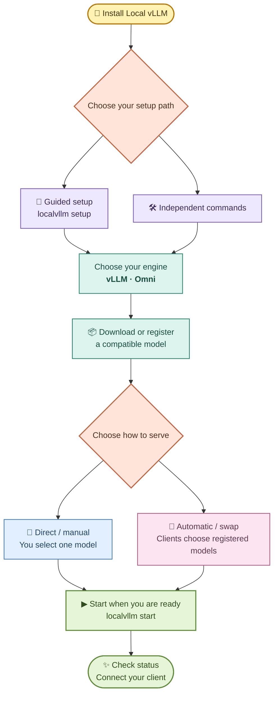

# Local AI Server for vLLM

<div align="center">
  
</div>

<div align="center">


</div>

Run [vLLM](https://github.com/vllm-project/vllm) and
[vLLM-Omni](https://github.com/vllm-project/vllm-omni) as two isolated local
OpenAI-compatible servers, managed by one small Bash CLI and two systemd user
services.

The repository directory is `localaivllm`; the installed command is
`localvllm`.

Use it on a supported workstation or GPU server, including multi-GPU systems
for large models. Context length, batching, GPU placement, and parallelism are
configurable per model; the defaults are starting points. See the
[large-model and multi-GPU guide](https://github.com/hossbit/comai-linux-assistant-wiki/blob/main/Local-vLLM-Advanced.md#multi-gpu).

This project is deliberately vLLM-only. It borrows the operational
conveniences of [Local AI Server](https://github.com/hossbit/local-ai-server)
— installer, CLI, model discovery, per-model overrides, API keys, doctor,
suggestions, benchmarks, systemd — and runs inference through vLLM's native server. Direct serving is the default;
[llama-swap](https://github.com/mostlygeek/llama-swap) is an optional routing layer.

<div align="center">
  <a href="https://github.com/hossbit/local-ai-server-vllm/releases/latest"></a>
  <a href="https://github.com/hossbit/local-ai-server-vllm/pulse"></a>
  <a href="https://github.com/hossbit/local-ai-server-vllm/stargazers"></a>
</div>

The download badge counts recorded repository clones, not unique users or release
asset downloads. Its total starts when badge tracking began.

## ❤️ Support

If you find Local vLLM useful, you can support its continued development:

<div align="center">
  <a href="https://donate.stripe.com/bJebJ0fzHeNc5F32fhaMU00">
    
  </a>
  <br>
  <strong><a href="https://donate.stripe.com/bJebJ0fzHeNc5F32fhaMU00">Donate via Stripe</a></strong>
  <br><br>
  <a href="https://buymeacoffee.com/mirhh">
    
  </a>
</div>

⭐ Starring and sharing the repository also helps.

## Get started

On a supported Linux computer with an NVIDIA GPU and working driver, run:

```bash
curl -fsSL https://hossbit.github.io/localvllm/install.sh | bash
```

The installer sets up the text engine automatically. If a compatible Python is
missing, it also downloads an isolated Python 3.12 without changing your system
Python. Installation may request sudo and needs internet and disk space. Then open a new terminal and run:

```bash
localvllm
```

`localvllm` shows commands. For a guided first setup, run **`localvllm setup`**;
for later interactive management, use `localvllm menu`. Neither is required.

### Choose your path



**The engine and serving method are separate choices.** vLLM handles text,
coding and supported vision-input/embedding models; Omni handles supported
multimodal generation and may need a model-specific recipe. Both support direct
and swap modes. Select models compatible with the chosen engine and your GPU.

| Independent path | Steps after installation |
| --- | --- |
| **Direct/manual (default)** | `pull ORG/MODEL` or `add /path/to/model` → `use MODEL` → `mode direct` → `start` |
| **Automatic switching** | `pull ORG/MODEL` or `add /path/to/model` → `mode swap` → `start` |

Prefix every step with `localvllm --backend vllm` or `localvllm --backend omni`.
For Omni, install its engine first with `localvllm backend install omni`.
Use `localvllm backend default omni` to persist your choice; a one-command
`--backend` override does not change it. The default engine need not be running.

Downloads and registration leave serving alone. For models added to an already
running router, use `reload` when ready; it may interrupt active requests.
Setup configures a stopped backend and leaves it stopped. It never starts a
service or model. If the chosen backend is running, it tells you to stop it first.

`ui --open` requires an already running backend: direct opens **API docs**
(`/docs`, not chat); swap opens the **model dashboard** (`/ui`). If stopped,
it prints a backend-specific start command without opening a dead page.
See `localvllm help paths` or the [workflow guide](https://github.com/hossbit/comai-linux-assistant-wiki/blob/main/Local-vLLM.md#choose-your-workflow).

Already installed and Omni reports a Python error? Run `localvllm update
--scripts-only`, then retry `localvllm backend install omni`.

For AMD, CPU, ARM64, or advanced setups, see the [installation guide](https://github.com/hossbit/comai-linux-assistant-wiki/blob/main/Local-vLLM.md#amd-and-cpu-installation).

## Why Local AI Server for vLLM?

Compare this managed vLLM server with vLLM, SGLang, Ollama, and Unsloth.
Unsloth also focuses on model training, while this project focuses on serving.

| Feature | **locallvllm** | Raw vLLM | SGLang | Ollama | Unsloth |
| --- | :---: | :---: | :---: | :---: | :---: |
| Easy setup | ✅ Guided CLI | ⚠️ Manual | ⚠️ Manual | ✅ Simple CLI | ✅ Studio UI |
| Text and multimodal | ✅ vLLM + Omni | ✅ Supported models | ✅ Supported models | ✅ Supported models | ✅ Supported models |
| OpenAI-compatible API | ✅ | ✅ | ✅ | ✅ Subset | ✅ Studio |
| Fine-tuning | — External tools | — External tools | ⚠️ Training integrations | — External tools | ✅ Built in |
| Linux service | ✅ Managed | ⚠️ Configure | ⚠️ Configure | ✅ Service | ⚠️ Configure |
| Separate vLLM + Omni | ✅ Managed | ⚠️ Separate setup | — Different engine | — Different engine | — Different workflow |
| Monitoring | ✅ CLI + metrics | ✅ Metrics + tools | ✅ Server tools | ✅ CLI + API | ✅ Training UI |
| Staged update rollback | ✅ Built in | ⚠️ Self-managed | ⚠️ Self-managed | — | — |

✅ Available or included · ⚠️ Requires extra setup or management · — Not a
matching feature here or handled by separate tools.

API endpoints, model support, hardware requirements, and performance vary by
version and configuration. Model downloads need network access; local inference
can run offline once the required files are available.

Sources: [vLLM documentation](https://docs.vllm.ai/),
[SGLang documentation](https://sgl-project.github.io/),
[Ollama documentation](https://docs.ollama.com/), and
[Unsloth](https://github.com/unslothai/unsloth).

### Main advantage

> One small, auditable Bash manager gives you **plain vLLM for text and
> vLLM-Omni for multimodal generation**, each with its own environment,
> models, port, service, API key, and tuning — without hand-writing pip
> commands or systemd units.

## Requirements

- Linux x86-64 or ARM64 and enough disk space. New environments use Python
  3.11–3.13; the installer can provide an isolated Python 3.12 if needed.
- An NVIDIA GPU with a working driver and enough VRAM for your chosen model is
  recommended. ROCm needs compatible wheels; CPU support is experimental.
  Fedora/RHEL and ARM64 availability depends on upstream packages and drivers.
  ROCm installs select Python 3.12 and verify that PyTorch is a ROCm build.
- The installer may need `sudo` for system packages. It does not install GPU
  drivers. See the [full requirements](https://github.com/hossbit/comai-linux-assistant-wiki/blob/main/Local-vLLM.md#requirements).

## Common commands

```bash
localvllm                       # Show available commands
localvllm setup                 # Guided first configuration; no service startup
localvllm menu                  # Optional interactive management
localvllm pull ORG/MODEL        # Download a model without switching the server
localvllm add /path/to/model    # Register a complete existing folder
localvllm mode                 # Show direct or automatic serving mode
localvllm status                # Check the selected backend
localvllm version               # Manager, engines, Python and optional router
localvllm update                # Active backend, llama-swap and helpers
localvllm update --all          # Every installed backend
localvllm models                # List models
localvllm start                 # Start the server
localvllm stop                  # Stop the server
localvllm ui --open             # Open API docs or the model dashboard
localvllm doctor all            # Diagnose both backends
localvllm config check          # Validate configuration without changing anything
localvllm backend install omni  # Add vLLM-Omni later
```

The default backend is `vllm`. Use `localvllm --backend omni` to target Omni.

Put your own complete model folder in `~/ai-vllm/models/vllm/` (or `models/omni/`).
Run `localvllm models --paths` to see storage locations, then select a folder
with `localvllm use FOLDER_NAME`. Existing folders elsewhere also work with
`localvllm use /path/to/model`. [Model storage guide](https://github.com/hossbit/comai-linux-assistant-wiki/blob/main/Local-vLLM.md#add-models).

Per-model tuning files in `conf/backends/<backend>/models.d/` are sourced as
Bash. They can set shell variables and arrays such as `EXTRA_ARGS`, so only
install or edit files you trust and keep them owned by your user.

For GGUF models, consider [Local AI Server](https://github.com/hossbit/local-ai-server),
which uses llama.cpp. [GGUF details](https://github.com/hossbit/comai-linux-assistant-wiki/blob/main/Local-vLLM-Advanced.md#gguf-models).

## Security

Servers listen on `127.0.0.1` by default. API keys do not protect every vLLM
endpoint. For network access, use a TLS reverse proxy with authentication.
Read the [security guide](https://github.com/hossbit/comai-linux-assistant-wiki/blob/main/Local-vLLM.md#security) before exposing a server.

## Help, logs and monitoring

```bash
localvllm help                     # Commands and common workflows
localvllm help models              # Also: modes, keys, logs, metrics, troubleshoot
localvllm logs --list              # All log files in one place
localvllm logs all --no-follow     # Recent output from all current files
localvllm metrics --watch          # Readable queue, cache and token statistics
```

Logs live in `~/ai-vllm/logs/` by default (`localvllm logs --path` shows your
actual directory). Use `--backend omni` for Omni. Metrics observe ready models
without loading them; `--raw` retains the native Prometheus output.

## Documentation

- [Getting started](https://github.com/hossbit/comai-linux-assistant-wiki/blob/main/Local-vLLM.md) — install, choose a model, and run the server.
- [AMD, CPU, and ARM64 setup](https://github.com/hossbit/comai-linux-assistant-wiki/blob/main/Local-vLLM.md#amd-and-cpu-installation) — hardware-specific guidance.
- [Commands](https://github.com/hossbit/comai-linux-assistant-wiki/blob/main/Local-vLLM-Advanced.md#commands) and [configuration](https://github.com/hossbit/comai-linux-assistant-wiki/blob/main/Local-vLLM-Advanced.md#configuration) — full reference and tuning options.
- [Troubleshooting](https://github.com/hossbit/comai-linux-assistant-wiki/blob/main/Local-vLLM.md#troubleshooting) — installation and runtime help.
- [vLLM](https://docs.vllm.ai/) and [vLLM-Omni](https://docs.vllm.ai/projects/vllm-omni/) — upstream documentation.

[Installer hub](https://hossbit.github.io/#localvllm) · [Report an issue](https://github.com/hossbit/local-ai-server-vllm/issues)

## License

MIT. See [LICENSE](LICENSE).
